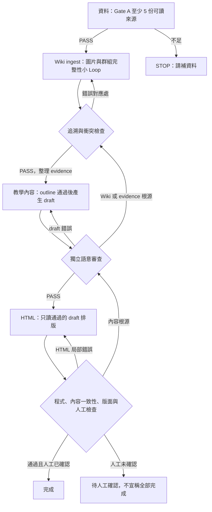

# 用 LLM Wiki 做一份教學 HTML 簡報

## 1. LLM Wiki 主題與簡短介紹

我的主題是「第一次辦活動：從企劃到執行與檢討」。我希望幫助第一次籌辦大學活動的人，知道不同階段該做什麼，從目的、分工、報名與預算，一路整理到現場執行和活動後的檢討。

這次先完成 8 題訪談，確認讀者、範圍、來源規則和 workflow，回覆「確認」後才建立專案。內容使用中文，以學長姊帶新手的方式說明，並且只根據提供的資料整理。

## 2. LLM Wiki 連結／成果

- Wiki 連結／本機路徑：[wiki/index.md](wiki/index.md)
- 公開 Wiki／GitHub 網址：尚未提供，待本人補上（若老師要求）。
- [來源清單](workflow/sources.md)、[ingest 紀錄](wiki/log.md)、[evidence](workflow/evidence.md)

這次共 ingest **9 份資料**，使用 **S01–S09** 管理來源。資料包括新生手冊、系烤企劃、系學會會議資料、系 T 訂購文件、迎新宣傳與送舊簽到表。新生手冊有 Word 和 PDF 兩種格式，重疊內容不算兩份獨立佐證；排除其中一份仍有 8 份資料。

Wiki 主要整理活動目的與對象、分工與期限、招募通知、表格與版本確認、物品預算、當天流程、結算及檢討。重要內容都有來源 ID 和可取得的位置。遇到日期、金額或時長不一致，就並列並標記待確認，不自行決定哪個答案正確。

## 3. 教學 HTML 簡報連結／成果

- HTML 連結／本機路徑：[workflow/deck.html](workflow/deck.html)
- 公開 HTML 網址：https://423156.github.io/Activity-wik/workflow/deck.html。
- [教學大綱](workflow/outline.md)、[逐頁草稿](workflow/draft.md)

簡報共 **14 頁**，包含封面與來源頁，目標讀者是第一次辦活動的初學者。內容由 Wiki／evidence 整理成 outline 和 draft，再把通過檢查的 draft 轉成 HTML，排版時不新增事實。

簡報提供上一頁、下一頁、方向鍵、首頁／末頁及選頁導覽。已通過 Desktop 1280×800 和 Mobile 390×844 的實際 Edge 渲染與逐頁視覺驗收，可以直接用瀏覽器開啟本機檔案。

## 4. Loop / Graph 的流程圖與文字說明

Graph 決定整體流程，節點內的小 Loop 負責「產出 → 檢查 → 只修 FAIL → 再檢查」。

| 主要節點 | 輸入 | 輸出與檢查 |
| --- | --- | --- |
| 資料 | raw 原始資料 | sources.md；至少 5 份可讀資料才繼續 |
| Wiki | raw 與確認後的需求 | index.md、log.md；檢查圖片、群組文字、來源追溯與矛盾 |
| 第一檢查關卡 | Wiki 與來源位置 | 通過的 Wiki 與 evidence.md |
| 教學內容 | Wiki／evidence；之後只用通過的 outline 與對應 evidence | outline.md、draft.md；先確認順序與覆蓋，再寫逐頁內容 |
| 第二檢查關卡 | Wiki／evidence 與 draft | 獨立語意審查結果；確認忠實度與來源 |
| HTML | 通過的 draft | deck.html；只處理排版與導覽 |
| 最後檢查與交件 | 成果檔案與實際測試 | validation、獨立逐頁 reviewer、瀏覽器驗收、report.md 與 submission.md |

不同錯誤退回不同節點：漏讀來源回 ingest／Wiki；evidence 整理錯誤只修 evidence；教學順序不好只修 outline；草稿失真只修對應段落；HTML 排版問題只修對應頁面。若根源在更上游，才回到那個來源節點。

PASS 的內容不重新生成，每個問題最多修 2 次，整體最多 3 輪。這樣比整份重跑有效率，因為只處理真的出錯的範圍，既減少重複閱讀與生成，也能節省 token，避免把已經正確的內容改出新問題。

## 5. 一次實際執行結果／檢查紀錄

以下是這次對現有成果進行的**最後驗收**，不是把先前製作過程的修正紀錄重新算一次。完整歷史保留在 [workflow/report.md](workflow/report.md)。

| 驗收階段 | 實際檢查方式 | 結果 | 退回／修改 |
| --- | --- | --- | --- |
| 程式 validation | 實際執行既有 validate.py，檢查檔案、來源、頁數、結構及 draft／HTML 一致性 | **11 PASS／0 FAIL**，退出碼 0 | 無 |
| 獨立 reviewer | 使用新的獨立 context，唯讀 Wiki、evidence、draft、HTML，逐頁檢查 | **42 PASS／0 REVIEW／0 FAIL**；忠實度、來源、教學性各 14 PASS；全稿覆蓋 PASS | 無 |
| HTML visual review | 實際用 Edge 開啟並逐頁查看 Desktop 1280×800、Mobile 390×844 | 電腦與手機各 14 張，共 **28 個頁面畫面**；按頁彙總 **14 PASS／0 FAIL** | 無 |
| 導覽與執行 | 電腦與手機各 26 次前後頁切換，另測方向鍵、Home／End、選頁及首末頁行為 | 全部正常，無 JavaScript 執行錯誤 | 無 |

所有檢查通過，沒有觸發退回節點，也沒有因驗收結果重新生成內容。

這次沒有發現文字溢出、裁切或重疊。手機第 13 頁比視窗高 2px，但可以自然捲動，沒有內容被藏起來，所以不判 FAIL。來源字級較小但可讀，電腦版留白也沒有造成操作問題。

以上結果不代表真人學習成效測試。來源正確性審查是對照 Wiki／evidence，沒有在這次 reviewer 審查中重新核對 raw。

## 6. 反思

我認為最容易出錯的是「逐頁草稿／忠實度」節點。把 Wiki 內容縮成簡短的教學文字時，容易出現來源錯置、過度簡化，或加進來源沒有支持的敘述。因此 workflow 沒有等到 HTML 完成後才檢查，而是把忠實度與來源檢查放在 Draft 完成之後、HTML 渲染之前。

這次**最後驗收**沒有出現 FAIL，所以沒有因這次驗收再次移動檢查節點，也沒有修改 Graph。我認為維持原本流程是合理的：前置檢查已放在教學內容生成與 HTML 渲染之間，後續程式檢查、新的獨立 reviewer 和實際瀏覽器驗收也全部通過，不需要為了顯得複雜而增加節點。

不過，「最後驗收沒有 FAIL」不代表整個製作過程從未發現問題。先前確實發現圖片及群組文字漏讀，以及草稿對保險單位的推定和未寫入 Wiki 的日期。那些問題已局部修正，也曾把圖片與群組檢查提前到 ingest 內；完整過程保留在 report.md。最後驗收沒有新增錯誤，我也沒有為了寫反思而假造問題。

如果未來某類錯誤反覆發生，我會把對應檢查再往更靠近錯誤來源的地方提前，而不是讓每種錯誤都整份重跑。通過的內容就保留，讓時間和 token 用在真正需要修正的地方。

最後，這份資料能幫助新手練習基本工作表，但沒有完整的申請核准、核銷操作、應變細節和完整事後檢討，不能說看完就能獨立辦好所有活動。這些限制已保留在成果中。交件前若老師要求公開網址或驗收截圖，我會補上自己的 GitHub／HTML 公開連結，並從已產生的驗收截圖中選取附件；目前不虛構公開網址。
